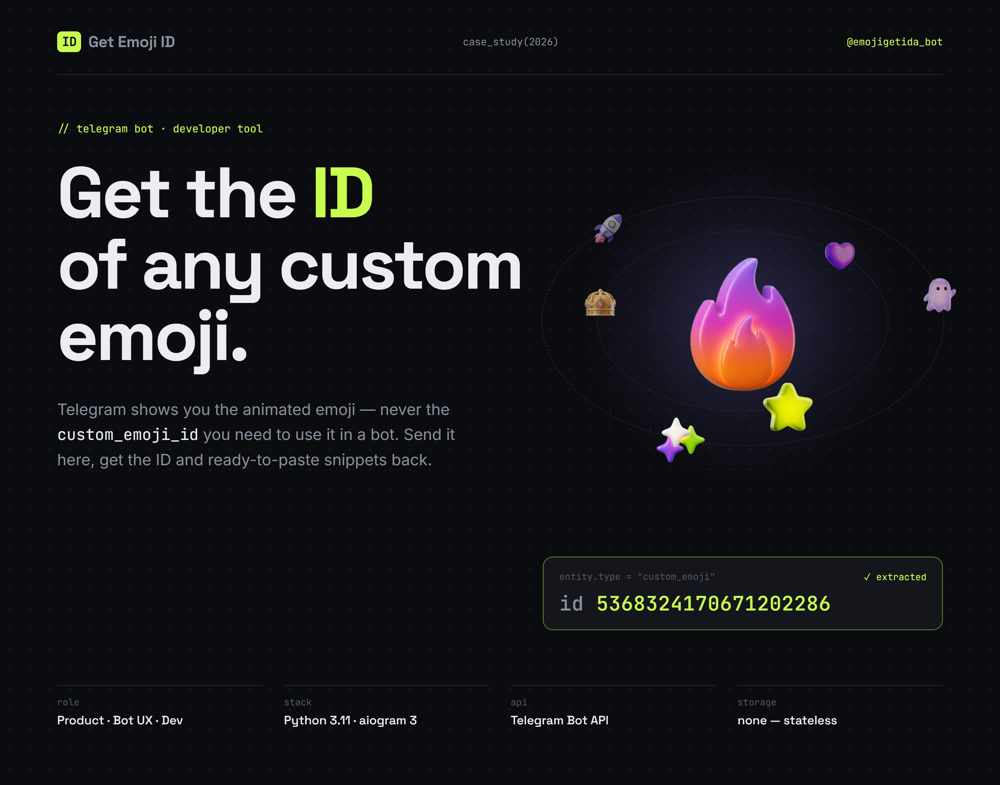
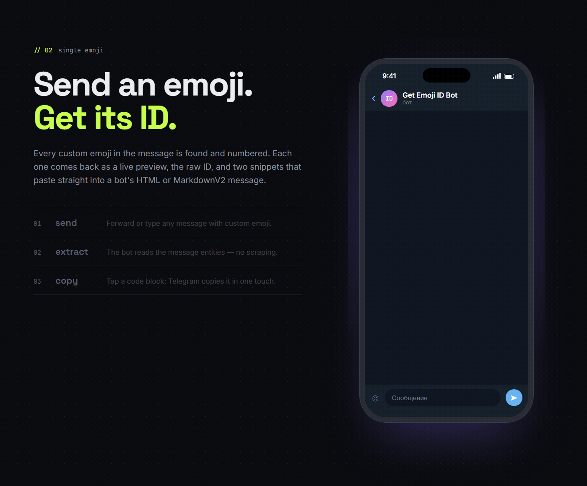
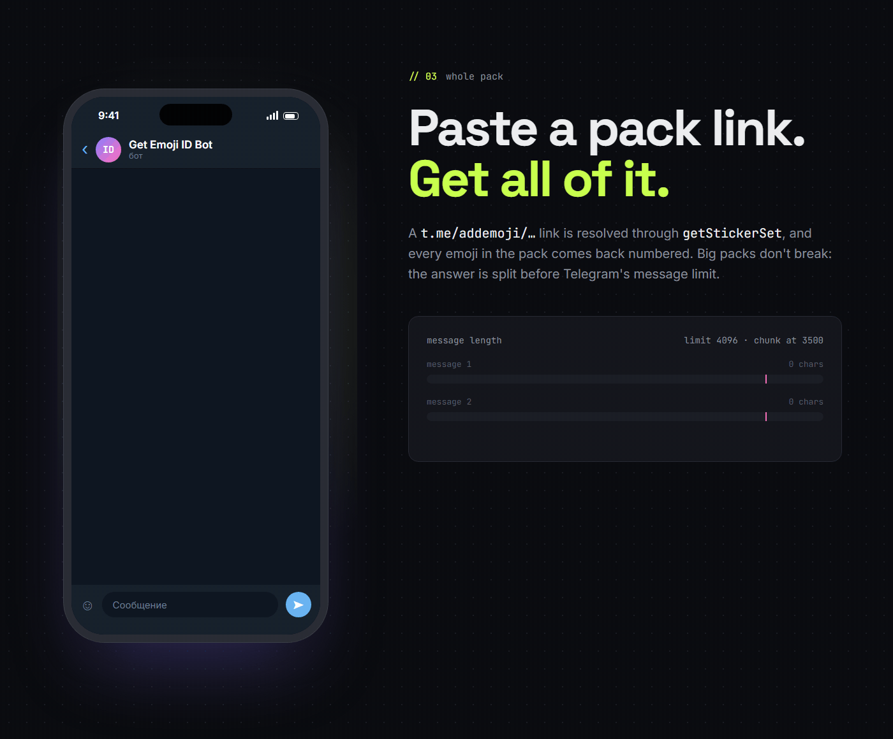
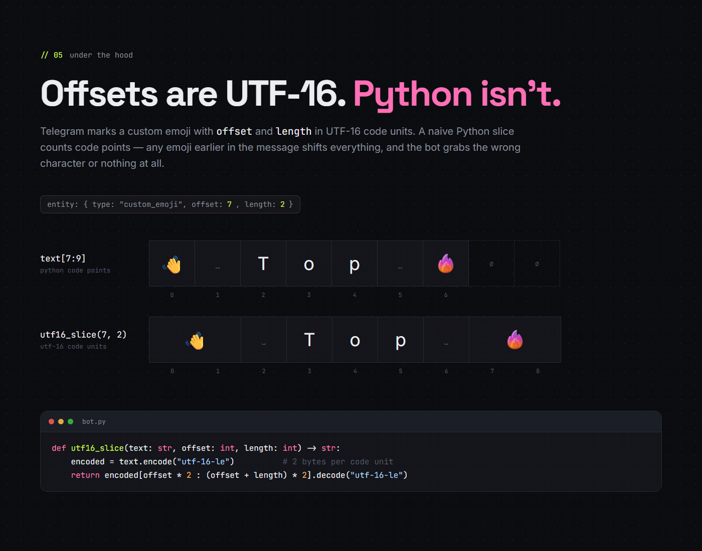

# Get Emoji ID — Telegram custom emoji ID bot



A small Telegram bot ([@emojigetida_bot](https://t.me/emojigetida_bot)) that returns the `custom_emoji_id` of any Telegram custom emoji — the ID you need to use that emoji in your own bot's messages. Telegram apps never show it.

- **Send custom emoji** (one or many, in any text) → get each ID plus ready-to-paste HTML and MarkdownV2 snippets.
- **Send a pack link** `https://t.me/addemoji/PackName` → get the IDs of every emoji in the pack.
- **Stateless:** no database, user messages are never logged or stored.

<p>
  
  
</p>

## Output

```html
<tg-emoji emoji-id="5368324170671202286">🔥</tg-emoji>
```

```

```

The fallback character from the original message is kept, so users without Telegram Premium still see a normal emoji.

## How it works

Custom emoji arrive as message entities of type `custom_emoji` with `offset` and `length` counted in **UTF-16 code units**. Slicing a Python `str` with those numbers counts code points instead, so any emoji earlier in the message shifts the result. The bot slices the UTF-16 encoding instead:

```python
def utf16_slice(text: str, offset: int, length: int) -> str:
    encoded = text.encode("utf-16-le")
    return encoded[offset * 2 : (offset + length) * 2].decode("utf-16-le")
```



Pack links are resolved with `getStickerSet`. Long answers are split into chunks under Telegram's 4096-character message limit, and if Telegram ever rejects the HTML reply the same content is re-sent as plain text.

## Stack

- Python 3.11+
- [aiogram](https://github.com/aiogram/aiogram) 3.x, long polling
- `BOT_TOKEN` from the environment (`.env`), no database

## Run it yourself

```bash
pip install -r requirements.txt
cp .env.example .env   # then put your token from @BotFather into .env
python bot.py
```

Never commit `.env` — the token gives full control over the bot. It is already in `.gitignore`.

---

## Русский

Telegram-бот на aiogram 3, который достаёт `custom_emoji_id` из:

- сообщения с одним или несколькими custom emoji;
- обычного текста, в котором встречаются custom emoji;
- ссылки на emoji pack вида `https://t.me/addemoji/PackName`.

### Установка и запуск

1. Создать бота через [@BotFather](https://t.me/BotFather) и получить токен.
2. `pip install -r requirements.txt`
3. `cp .env.example .env` и вписать токен: `BOT_TOKEN=123456:ABC...`
4. `python bot.py`

**Никогда не коммить `.env` и не публиковать токен** — он даёт полный контроль над ботом. Файл `.env` уже добавлен в `.gitignore`.

### Использование

- `/start` — краткая инструкция.
- Отправь боту custom emoji (или текст с ними) — в ответ придёт `custom_emoji_id` и готовые фрагменты для HTML и MarkdownV2.
- Отправь ссылку `https://t.me/addemoji/PackName` — бот запросит набор через `getStickerSet` и пришлёт все `custom_emoji_id` из пака. Большие паки разбиваются на несколько сообщений из-за лимита Telegram в 4096 символов.

Если в сообщении нет custom emoji (например, обычный emoji с клавиатуры) или ссылка на пак битая — бот сообщит об этом отдельным текстом.

### Безопасность

- `BOT_TOKEN` не логируется.
- Содержимое пользовательских сообщений не логируется и нигде не сохраняется.
- Бот не использует базу данных и не хранит историю.

## License

MIT — see [LICENSE](LICENSE).
